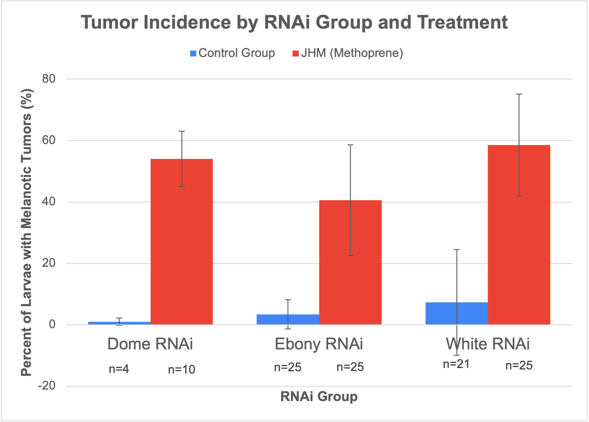

# CCNY DNA Detectives

## Domeless RNAi and Methoprene-Induced Melanotic Tumors

**Unpublished team research report**

**Paper:** *Effects of JAK-STAT pathway on melanotic tumors induced by juvenile hormone mimics*

**Authors, in original order:** Christopher Wong, Wenhao Jia, Fuad Ahmed, Sneha Sarkar.

[Read the complete team paper (PDF)](CCNY-DNA-Detectives-Unpublished-Team-Paper.pdf)

[View the team presentation (PDF, 21 slides)](CCNY-DNA-Detectives-Team-Presentation.pdf)

## Research question

Does knocking down the Domeless receptor through RNA interference reduce methoprene-induced melanotic tumor formation in *Drosophila melanogaster*?

The team's hypothesis was that reducing Domeless-mediated JAK-STAT signaling would decrease tumor formation after exposure to the juvenile hormone mimic methoprene.

## Study design

The study compared three RNAi groups, **Domeless, Ebony, and White**, under two conditions: methoprene treatment and an ethanol vehicle control. The team assessed melanotic tumor incidence and pupal eclosion, summarized vial-level percentages, and used pairwise chi-square comparisons of pooled counts.

As credited in the paper's Methods, Mr. Luu prepared the fly stocks and administered the treatments. The contributions listed below describe my role in the team project.

## Main findings

- The paper reports higher tumor incidence and lower pupal eclosion in the methoprene-treated groups than in the ethanol controls.
- The reported tumor comparison between Domeless RNAi and White RNAi was not statistically significant: **chi-square = 2.72; p = 0.10**.
- The results did not support the predicted reduction in tumor formation under the tested conditions. A non-significant comparison does not by itself rule out JAK-STAT involvement or establish an alternative pathway.

The paper discusses limitations including the small Domeless control group, variability between control groups, and the use of a single juvenile hormone mimic. These findings summarize the team report; no independent reanalysis is presented here.

## My contributions - Wenhao Jia

### Written paper

- Contributed to the mechanism and RNA interference (RNAi) content in the Introduction.
- Contributed to the Results section.
- Prepared Figure 1.
- Contributed to the Conclusion.

### Presentation

My contributions covered the following presentation sections:

- Mechanism.
- RNA interference (RNAi).
- Results: Figure 1.
- Limitations.
- Future directions.

## Selected figure

*Figure 1 from the original team paper, prepared by Wenhao Jia. The figure and its labels are reproduced unchanged. See the PDF for the complete caption and results.*

## Full report

[Open the original, complete PDF](CCNY-DNA-Detectives-Unpublished-Team-Paper.pdf) for the Introduction, Methods, Results, Discussion, figures, and references. The original document is retained without edits and is identified here as an unpublished team research report.

## Team presentation

[Open the presentation slides (PDF, 21 slides)](CCNY-DNA-Detectives-Team-Presentation.pdf)

*Group 2 - RNAi knockdown of Domeless in Drosophila melanogaster* is the team's presentation of the same research project. It covers the background, hypothesis, experimental design, results, limitations, and future directions. The original slides are preserved without edits. My contributions to the written paper and presentation are listed separately above.
